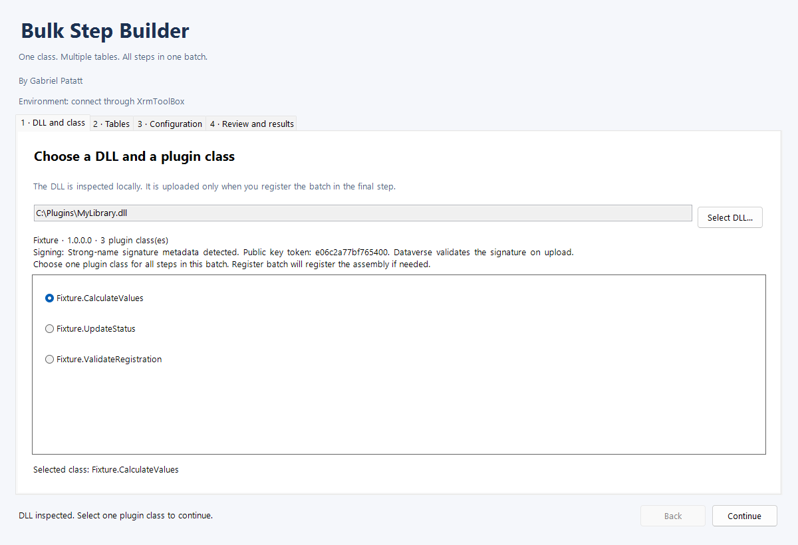
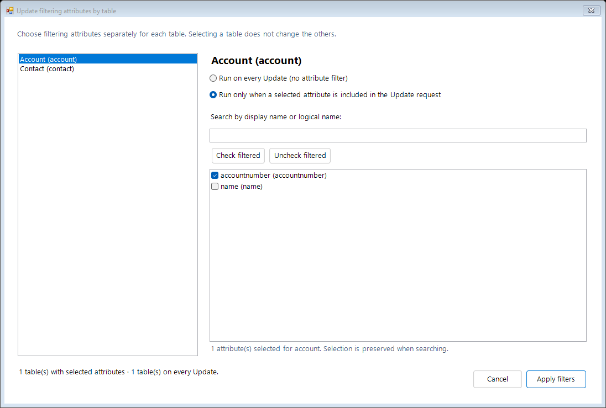
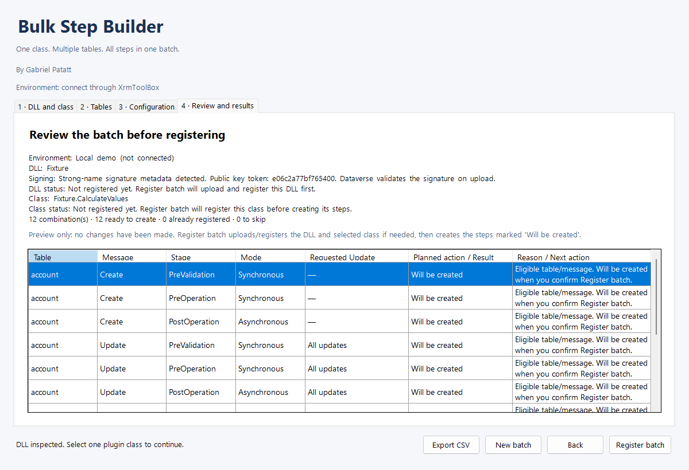

# Bulk Step Builder for XrmToolBox

**Author: Gabriel Patatt** | Version 1.0.0

[Project](https://github.com/G-Patatt/BulkStepBuilder) · [Report an issue](https://github.com/G-Patatt/BulkStepBuilder/issues) · [MIT license](LICENSE)

Register multiple Dataverse plugin steps for **one class selected from a DLL on your computer**.

## Install and run

For an existing installation, close all XrmToolBox windows and run `./Install.ps1` from this project folder. It installs the DLL, verifies its hash, and synchronizes this tool's cached version, assembly identity and author. It preserves other tools and saves backups under `install-backups/`. It refuses to replace a tool while XrmToolBox is running, which prevents stale metadata from being written against a new DLL. Use `-PluginsPath` if your installation uses a custom data directory.

1. Close XrmToolBox.
2. Copy **only** `dist/Plugins/BulkStepBuilder.dll` into the `Plugins` folder of your XrmToolBox data directory. The default location is usually `%APPDATA%\MscrmTools\XrmToolBox\Plugins`. Check your data directory if you use `/overridepath`.
3. If Windows blocks the downloaded DLL, open its Properties and select **Unblock** before starting XrmToolBox.
4. Open XrmToolBox and find **Bulk Step Builder** in the installed tools list.
5. Connect to a development environment with plugin registration permissions.
6. Select your business plugin DLL, choose **one** of its classes, select tables, configure combinations, and click **Generate preview**.
7. Check the environment, class and each combination. **Register batch** asks for confirmation before uploading the DLL and creating active steps.

`BulkStepBuilder.dll` is an XrmToolBox extension. Do not register it in Dataverse. The DLL you select **inside the tool** contains your business plugin classes.

## Features

- Parse DLL metadata from memory using Mono.Cecil. User assemblies are never loaded into the CLR, plugin constructors are not executed, and DLL files are released after inspection. Repeated inspection and rebuilt DLLs do not share a CLR assembly cache.
- Discover public, concrete, non-generic classes implementing `Microsoft.Xrm.Sdk.IPlugin`, including inherited implementations.
- Show signing status immediately after inspection. Unsigned and delay-signed DLLs cannot advance; instructions explain how to rebuild with a strong-name key (.snk). A public key and signing flag are metadata checks, not cryptographic verification; Dataverse validates the uploaded signature. Authenticode certificates are separate from strong-name signing. The tool does not sign DLLs or provision certificates.
- Choose one class per batch using explicit radio buttons. If the DLL contains three plugin classes, all three are listed and the user selects one. No class is selected automatically; Continue is enabled only after a selection. The selected class name is shown below the choices.
- Load tables from the active connection. Search by display or logical name, select multiple tables, and check or uncheck filtered results while preserving other selections.
- Combine Create, Update and Delete with PreValidation, PreOperation and PostOperation.
- Synchronous execution for earlier stages; synchronous or asynchronous execution for PostOperation.
- Configure execution order, Update filtering attributes per table and optional unsecure configuration. The Select attributes dialog lists each selected table, searches by display/logical name, and preserves independent checkbox selections. Each table can explicitly use selected attributes or every Update request. Review and CSV show the requested per-table filters. Existing steps are preserved; these choices apply to newly created Update steps.
- Preview without changes to the environment. Unsupported table/message combinations are skipped.
- Review shows DLL and class registration status separately from step eligibility. An unregistered DLL is planned for upload during Register batch; it does not make steps unavailable. Each row explains its planned action. Empty registration metadata produces a validation error instead of silently classifying every combination as unsupported.
- Registration metadata is resolved using message IDs without joined aliases. Table filters accept logical names and available object type codes, and both empty values and `none` represent no secondary table.
- Register new assemblies in **Sandbox / Database**. Reuse identical existing DLLs. Updating different content with the same identity requires the explicit update option and appears in the review.
- Detect existing steps by class + message + table filter + stage + mode. Existing steps are preserved, including disabled steps or steps with different configuration.
- Individual creation results, failures and IDs. Export previews or results to CSV.
- Errors identify the failed phase, the server reason/code and a recommended action for signing, permissions, dependencies or timeouts. Double-click a result row to read its full details. If assembly/class setup fails, pending steps show **Not attempted**; changes that may already have been saved are explained. A signing-key mismatch shows both public key tokens and asks for a rebuild with the original key.

Example: 2 tables x 2 messages x 3 stages produce 12 combinations for the same class. Existing steps and unsupported combinations reduce the number of new steps.

## Current limitations

- **Gabriel Patatt confirmed the complete flow is working in a development environment on 2026-10-20 (user-reported validation for 0.1.7).** Version 1.0.0 carries that implementation forward with a release-version change only. Automated local checks use a simulated service. Version 0.1.7 was published to NuGet; 1.0.0 is prepared for upload. Tool Library approval is a separate step.
- Windows and .NET Framework 4.8. Built against XrmToolBoxPackage `1.2025.10.74`; `MscrmTools.Xrm.Connection` is pinned to `1.2025.9.64` to match the host package's binary reference.
- Traditional strong-name-signed DLL registration only. No plugin packages (`.nupkg`) or automatic dependency deployment. Keep dependency DLLs next to the main DLL for inspection; their deployment remains the responsibility of the business assembly/package.
- No Pre/Post images, secure configuration, impersonation, solution membership or migrations between assembly identities. Components remain in the default solution and must be added to your distribution solution separately.
- Registration is blocked if multiple assemblies share the same name, or an existing assembly has a different version, culture or public key token. Updates removing registered classes are also blocked.
- Filtering attributes are configured separately for each table. In the attribute picker, every-Update mode means no attribute filter; selected-attribute mode requires at least one valid field. The plugin runs when an Update request includes at least one selected attribute, even if its value is unchanged. Primary keys are rejected as filtering attributes. The underlying API retains the legacy shared-filter property for compatibility; per-table choices take precedence.
- Registration is sequential and may partially succeed. The assembly may be saved even when a step fails. After a failure, generate a **new preview**; existing steps will be preserved. No automatic rollback or component deletion.
- Duplicate detection is not a distributed lock. Avoid concurrent batches targeting the same class and combinations. Additional server-side stage/mode restrictions may cause individual failures shown in the results.
- Each operation uses the service captured from its initial connection. Changing connections discards stale interface data and reports the change, but does not undo writes already started on the previous connection.
- Dataverse table display names and server-generated error messages use the environment's language. Class names come directly from your DLL.

## Build and test

From the project folder, with a .NET SDK installed and NuGet access:

```powershell
.\build.ps1 -Test
```

Tests run as a .NET Framework 4.8 executable using assertions and a simulated `IOrganizationService`, without an external connection. The fixture contains three public concrete plugin classes whose constructors throw if executed. The public `tests/Fixture/fixture.snk` key is for tests only; do not use it to sign production software.

Additional unsigned and delay-signed fixtures exercise signing validation. Previewing a DLL does not register anything; a signed business DLL does not need to be manually registered in PRT before using this tool.

The separate InspectorHost regression test loads identical copies of the tool in different .NET assembly contexts. It verifies that DLL inspection succeeds without CLR assembly loading, remoting or temporary AppDomains, even when host assemblies use different load contexts.

Version 0.1.3 removes the remoting-based inspector entirely. DLL inspection now parses metadata with Mono.Cecil, and errors include the actual exception type and message instead of guessing that a user DLL is invalid. After replacing the tool DLL, close all XrmToolBox windows and reopen the application before selecting a business DLL.

Render the interface with local demonstration data:

```powershell
.\tests\BulkStepBuilder.Tests\bin\Release\net48\BulkStepBuilder.Tests.exe .\preview
```

Project structure:

```text
src/BulkStepBuilder/          WinForms extension, DLL inspection and registration service
tests/Fixture/               Test DLL with three concrete plugins
tests/BulkStepBuilder.Tests/  Registration, duplicate detection and validation tests
dist/Plugins/                DLL for manual XrmToolBox installation
preview/                     Wizard images rendered with simulated data
```

## Validate in a development environment

1. Use a signed, Dataverse-compatible business test DLL with three IPlugin classes and harmless behavior.
2. Select one class and two test tables. Select Create/Update and PreOperation/PostOperation.
3. Review the eight combinations, verify the connection name and register the batch.
4. In Plugin Registration Tool, verify the assembly and each step's class, table, message, stage, mode and execution order.
5. Generate the same preview again. The combinations should appear as **Existing**, without additional steps.
6. Select another class from the same DLL. Its preview should prepare a separate batch for that class.
7. Test Update filtering attributes, a controlled permission failure and result export.

## References

- [XrmToolBox developer documentation](https://www.xrmtoolbox.com/documentation/for-developers/)
- [Dataverse plugin registration and execution restrictions](https://learn.microsoft.com/en-us/power-apps/developer/data-platform/register-plug-in)
- [Dataverse assembly signing and plugin packages](https://learn.microsoft.com/en-us/power-apps/developer/data-platform/build-and-package)
- [Publishing to the Tool Library](https://www.xrmtoolbox.com/documentation/for-developers/deploy-your-plugin-in-plugins-store/)

## NuGet package and Tool Library submission

The distribution package ID is **GabrielPatatt.BulkStepBuilder**. Run `./Pack.ps1 -VerifyPublicUrls` on Windows to build, test, package and validate it. The package includes the merged DLL under `lib/net48/Plugins`, an embedded icon and README, the MIT license and third-party notices. It declares the `XrmToolBox` host compatibility dependency rather than the development dependency `XrmToolBoxPackage`.

See [PUBLISHING.md](PUBLISHING.md) for the validation record, NuGet upload and XrmToolBox submission steps. The GitHub Actions workflow produces a validated package artifact. Creating a package or pushing source code does not publish the package or imply approval in the Tool Library.

## Interface previews

The following screenshots use local demonstration data:





Copyright 2026 Gabriel Patatt.

Mono.Cecil 0.11.6 is merged and internalized into the tool DLL at build time using ILRepack 2.0.48. No separate reader DLL needs to be installed. See THIRD-PARTY-NOTICES.txt for its MIT license.
